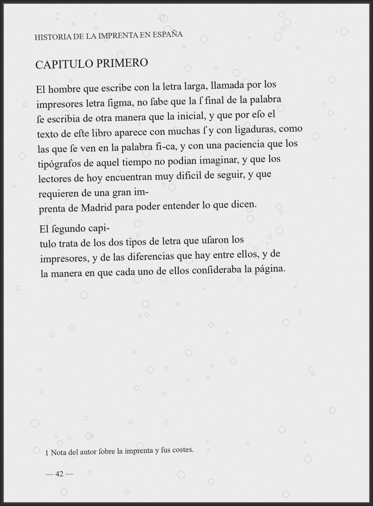
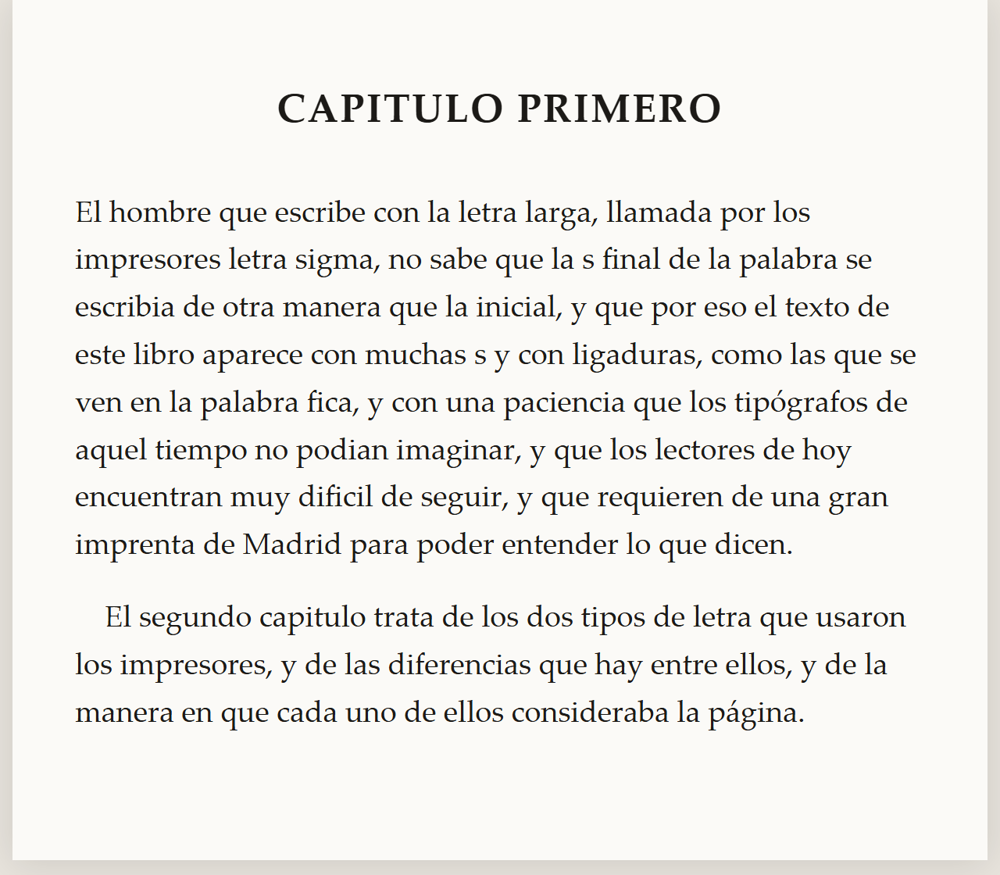
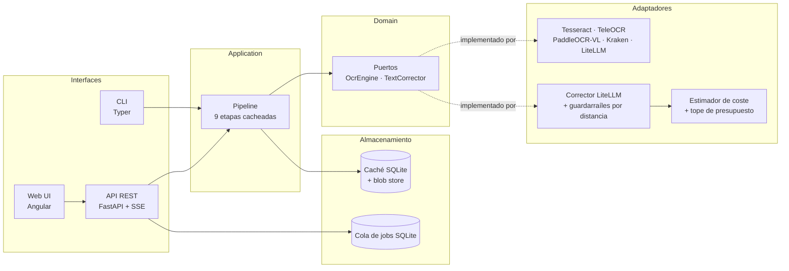

# scan2epub

**Convierte libros escaneados de dominio público en EPUB 3 limpio y refluible — con IA si quieres, totalmente offline si no.**

[](LICENSE)
[](https://www.python.org/)
[](CODE_OF_CONDUCT.md)

> Read it in your language: [English (README.md)](README.md)

---

## Por qué

Los libros escaneados de los siglos XVIII y XIX son un desastre para leer en un
e-reader:

- **ſ** (s larga) y ligaduras tipográficas (`ct`, `st`, `ſt`) en lugar de letras modernas.
- **Guiones de fin de línea** partiendo palabras.
- **Cabeceras, pies y folios** en todas las páginas.
- Párrafos que **se parten entre páginas**.
- Manchas, páginas torcidas, foxing, lomo deformado.
- Dos columnas, notas al pie, ilustraciones, Marginalia.

`scan2epub` reconstruye esas páginas como un **EPUB 3 refluible**: tú eliges
fuente, tamaño, interlineado, márgenes y tema (claro / oscuro / sepia) y el
lector hace el resto.

Está pensado para **literatura de dominio público**, con foco especial en
material **en español** de los siglos XVIII y XIX.

## Antes / después

| Página escaneada | EPUB 3 generado (refluible) |
| --- | --- |
|  |  |

> El mismo contenido: la cabecera desapareció, la `ſ` se normalizó, las
> palabras partidas se unieron y el párrafo fluye con naturalidad.
>
> Las imágenes se generan con `uv run python scripts/make_readme_images.py`.

## Instalación rápida

### Un comando con Docker

```bash
docker compose up
```

Luego abre <http://localhost:8000> y arrastra un PDF.

### Instalación local

```bash
git clone https://github.com/WassimAarab08/scan2epub.git
cd scan2epub
uv sync --all-extras
uv run scan2epub convert libro.pdf -o libro.epub
```

Requiere Python 3.12+ y (para el motor por defecto) el binario `tesseract`.

### La interfaz web

```bash
uv run scan2epub serve --host 127.0.0.1 --port 8000
```

<http://localhost:8000> ofrece una página sencilla que sube un PDF, lo
convierte y deja descargar el EPUB. La misma conversión está disponible en
la API REST, documentada en `/docs`.

## CLI

```bash
# Solo OCR local — totalmente offline, sin claves de API, sin red
scan2epub convert libro.pdf -o libro.epub --ocr tesseract

# Modelo local de visión-lenguaje (mejor con escaneos degradados)
scan2epub convert libro.pdf -o libro.epub --ocr teleocr

# VLM local + post-corrección con LLM local vía Ollama
scan2epub convert libro.pdf -o libro.epub --ocr paddleocr-vl --llm ollama/qwen3

# VLM remoto a través de LiteLLM (cualquier proveedor compatible con OpenAI)
scan2epub convert libro.pdf -o libro.epub --ocr litellm/gemini-2.5-flash

# Estima el coste antes de gastar dinero
scan2epub estimate libro.pdf --ocr litellm/gpt-4o-mini --llm litellm/gpt-4o-mini
```

Más ejemplos en [`docs/usage.md`](docs/usage.md).

## Funcionalidades

- **Limpieza determinista primero.** Cabeceras, folios, guiones de fin de línea,
  `ſ` larga, ligaduras y párrafos partidos entre páginas se arreglan con reglas
  deterministas: sin modelo, totalmente reproducible.
- **IA enchufable.** `OcrEngine` y `TextCorrector` son puertos. Tesseract,
  TeleOCR, PaddleOCR-VL, Kraken y cualquier modelo remoto soportado por LiteLLM
  llegan como adaptadores. Añade el tuyo en menos de 50 líneas.
- **Post-corrección con LLM segura.** Las correcciones que se alejan demasiado
  del original (distancia de edición normalizada) se rechazan y se conserva el
  original. Todos los diffs se guardan para revisión.
- **Control de coste.** Estimación de tokens y precio antes de una ejecución de
  pago, tope de presupuesto estricto, reintentos con backoff exponencial y
  rate limiting. Las claves de API solo se leen de variables de entorno y
  nunca se registran.
- **Reanudable.** Cada etapa se cachea por página, indexada por hash de
  contenido, así que un trabajo de 800 páginas interrumpido continúa donde estaba.
- **EPUB 3 hecho a mano.** Sin `EbookLib`. El CSS es mínimo y nunca fuerza
  fuente ni tamaño: manda el lector.
- **Lector propio.** Una app web Angular con subida por arrastrar y soltar,
  revisión página a página junto al escaneo y lector integrado con controles de
  fuente/tamaño/interlineado/márgenes y temas claro/oscuro/sepia.

## Arquitectura



Detalles completos: [`docs/architecture.md`](docs/architecture.md).

## Estructura del proyecto

```
src/scan2epub/
├── domain/           # Modelos y puertos puros (sin I/O, sin frameworks)
├── application/      # Etapas del pipeline, caché, orquestación de jobs
├── infrastructure/   # Adaptadores: OCR, corrección, imagen, PDF, EPUB, almacenamiento
├── api/              # App FastAPI, routers, SSE, worker        (Fase 4)
├── cli/              # Comandos Typer
└── eval/             # Métricas CER / WER y runner de benchmarks (Fase 2)
```

## Pruebas

La suite tiene cuatro capas. La del navegador es la más eloquent: el libro
generado se abre en **foliate-js**, el lector EPUB 3 de referencia, en un
Chromium real, y se comprueba que refluye, que la navegación funciona y que
las notas al pie están enlazadas.

```bash
uv run pytest                                        # todo
uv run pytest tests/browser -v                       # el navegador real
uv run pytest --cov=src/scan2epub --cov-report=term  # con la cobertura
```

Véase [`docs/testing.md`](docs/testing.md).

## Benchmarks

Véase [`docs/benchmarks.md`](docs/benchmarks.md) para la tabla completa y el
script de reproducción.

| Motor | Modo | CER ↓ | WER ↓ | Velocidad (s/página, RTX 4090) |
| --- | --- | --- | --- | --- |
| _Pendiente_ | | | | |

## Hoja de ruta

- [x] Fase 0 — repositorio, licencia, documentación, esqueleto de CI
- [ ] Fase 1 — MVP: Tesseract → limpieza determinista → EPUB 3 válido
- [ ] Fase 2 — motores VLM locales (TeleOCR, PaddleOCR-VL), caché, reanudación, eval CER/WER
- [ ] Fase 3 — OCR remoto + corrección con LLM vía LiteLLM, guardarraíles y control de coste
- [ ] Fase 4 — FastAPI, cola de jobs en SQLite, proceso worker, progreso por SSE
- [ ] Fase 5 — Web UI Angular, revisión página a página, lector integrado
- [ ] Fase 6 — Docker (CPU/GPU), CI completa, documentación, release v0.1.0

## Documentación

| Documento | Contenido |
| --- | --- |
| [`docs/architecture.md`](docs/architecture.md) | Capas, contratos de etapa, modelo de datos, seguridad del corrector |
| [`docs/adding-an-engine.md`](docs/adding-an-engine.md) | Escribe tu propio `OcrEngine` / `TextCorrector` en menos de 50 líneas |
| [`docs/configuration.md`](docs/configuration.md) | `config.toml`, variables de entorno, proveedores |
| [`docs/usage.md`](docs/usage.md) | Referencia de la CLI y recetas |
| [`docs/testing.md`](docs/testing.md) | Las cuatro capas de la suite y los tests de navegador |
| [`docs/epub-layout.md`](docs/epub-layout.md) | La anatomía del EPUB generado, archivo por archivo |
| [`docs/benchmarks.md`](docs/benchmarks.md) | Metodología de evaluación y resultados |
| [`docs/naming.md`](docs/naming.md) | Por qué el proyecto se llama `scan2epub` |
| [`CONTRIBUTING.md`](CONTRIBUTING.md) | Flujo de desarrollo, convención de commits |
| [`SECURITY.md`](SECURITY.md) | Reportar vulnerabilidades |
| [`THIRD_PARTY_LICENSES.md`](THIRD_PARTY_LICENSES.md) | Licencias de dependencias y librerías copyleft descartadas |

## Contribuir

Las contribuciones son muy bienvenidas — mira
[CONTRIBUTING.md](CONTRIBUTING.md) y [CODE_OF_CONDUCT.md](CODE_OF_CONDUCT.md).
Sobre todo, añadir motores de OCR y correctores nuevos; la guía explica cómo
en menos de 50 líneas.

## Licencia

[Apache License 2.0](LICENSE) — consulta también
[THIRD_PARTY_LICENSES.md](THIRD_PARTY_LICENSES.md).
