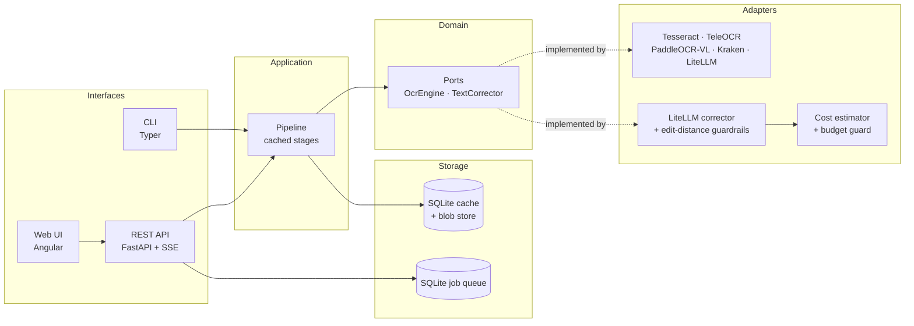

# scan2epub

**Turn scanned public-domain books into clean, reflowable EPUB 3 — with AI when you want it, fully offline when you don't.**

[](LICENSE)
[](https://www.python.org/)
[](CODE_OF_CONDUCT.md)

> Read it in your language: [Español (README.es.md)](README.es.md)

---

## Why

Scanned books from the 18th and 19th centuries are a mess to read on an e-reader:

- Long **ſ** (long s) and typographic ligatures (`ct`, `st`, `ſt`) instead of modern letters.
- **Hyphenation at the end of the line** splitting words across lines.
- Running **headers, footers and page numbers** on every page.
- Paragraphs that **break across pages**.
- Ink blots, skewed pages, foxing, warped binding.
- Two-column layouts, footnotes, illustrations, marginalia.

`scan2epub` rebuilds those pages as a **reflowable EPUB 3** document: you pick the
font, the size, the line height, the margins and the theme (light / dark /
sepia) and the reader does the rest.

It is built for **public-domain literature**, with a particular focus on
**Spanish-language** material from the 18th and 19th centuries.

## Before / after

| Scanned source page | Generated EPUB 3 (reflowable) |
| --- | --- |
|  |  |

> The same content: the running head is gone, the long `ſ` is normalised, the
> hyphenated words are rejoined and the paragraph flows naturally.
>
> The images are generated by `uv run python scripts/make_readme_images.py`.

## Quick start

### One command with Docker

```bash
docker compose up
```

Then open <http://localhost:8000> and drop a PDF in.

### Local install

```bash
git clone https://github.com/WassimAarab08/scan2epub.git
cd scan2epub
uv sync --all-extras
uv run scan2epub convert libro.pdf -o libro.epub
```

Requires Python 3.12+ and (for the default engine) the `tesseract` binary.

### The web interface

```bash
uv run scan2epub serve --host 127.0.0.1 --port 8000
```

<http://localhost:8000> offers a small page that uploads a PDF, converts it
and offers the EPUB for download. The same conversion is available over the
REST API, documented at `/docs`.

## CLI

```bash
# Local OCR only — fully offline, no API keys, no network
scan2epub convert libro.pdf -o libro.epub --ocr tesseract

# What does this installation support?
scan2epub doctor

# Local vision-language model (better on degraded scans)
scan2epub convert libro.pdf -o libro.epub --ocr teleocr

# Local VLM + local LLM post-correction via Ollama
scan2epub convert libro.pdf -o libro.epub --ocr paddleocr-vl --llm ollama/qwen3

# Remote VLM through LiteLLM (any OpenAI-compatible provider)
scan2epub convert libro.pdf -o libro.epub --ocr litellm/gemini-2.5-flash

# Show the estimated cost before spending money
scan2epub estimate libro.pdf --ocr litellm/gpt-4o-mini --llm litellm/gpt-4o-mini
```

More examples in [`docs/usage.md`](docs/usage.md).

## Features

- **Deterministic cleaning first.** Running heads, folio numbers, end-of-line
  hyphens, long `ſ`, ligatures and cross-page paragraphs are fixed with
  deterministic rules — no model required, fully reproducible.
- **Pluggable AI.** `OcrEngine` and `TextCorrector` are ports. Tesseract,
  TeleOCR, PaddleOCR-VL, Kraken, and any LiteLLM-supported remote model ship as
  adapters. Add your own in under 50 lines.
- **Safe LLM post-correction.** Corrections that drift too far from the original
  (normalized edit distance) are rejected and the original is kept. Every diff
  is stored for review.
- **Cost control.** Token and price estimation before a paid run, a hard
  budget cap, retries with exponential backoff and rate limiting. API keys are
  only read from environment variables and are never logged.
- **Resumable.** Every stage is cached per page, keyed by content hash, so an
  interrupted 800-page job continues where it stopped.
- **Hand-written EPUB 3.** No `EbookLib`. The CSS is minimal and never forces a
  font or a font size, so reader preferences win.
- **Own reader.** An Angular web app with drag-and-drop upload, per-page
  side-by-side review against the scan, and an integrated reader with
  font/size/line-height/margin controls and light/dark/sepia themes.

## Architecture



Full details: [`docs/architecture.md`](docs/architecture.md).

## Project layout

```
src/scan2epub/
├── domain/           # Pure models and ports (no I/O, no framework imports)
├── application/      # Pipeline stages, cache, job orchestration
├── infrastructure/   # Adapters: OCR, correction, imaging, PDF, EPUB, storage
├── api/              # FastAPI app, routers, SSE, worker     (Phase 4)
├── cli/              # Typer commands
└── eval/             # CER / WER metrics and benchmark runner (Phase 2)
```

## Testing

The suite has four layers. The browser one is the most telling: the
generated book is opened in **foliate-js**, the reference EPUB 3 reader, in a
real Chromium, and checked for reflow, working navigation and linked
footnotes.

```bash
uv run pytest                                        # everything
uv run pytest tests/browser -v                       # the real browser
uv run pytest --cov=src/scan2epub --cov-report=term  # with the coverage
```

See [`docs/testing.md`](docs/testing.md).

## Benchmarks

See [`docs/benchmarks.md`](docs/benchmarks.md) for the full table and the
reproduction script.

| Engine | Mode | CER ↓ | WER ↓ | Speed (s/page, RTX 4090) |
| --- | --- | --- | --- | --- |
| _TBD_ | | | | |

## Roadmap

- [x] Phase 0 — repository, license, docs, CI skeleton
- [ ] Phase 1 — MVP: Tesseract → deterministic cleaning → valid EPUB 3
- [ ] Phase 2 — local VLM engines (TeleOCR, PaddleOCR-VL), caching, resume, CER/WER eval
- [ ] Phase 3 — LiteLLM remote OCR + LLM correction with guardrails and cost control
- [ ] Phase 4 — FastAPI, SQLite job queue, worker process, SSE progress
- [ ] Phase 5 — Angular web UI, page-by-page review, integrated reader
- [ ] Phase 6 — Docker (CPU/GPU), full CI, documentation, v0.1.0 release

## Documentation

| Document | Contents |
| --- | --- |
| [`docs/architecture.md`](docs/architecture.md) | Layers, stage contracts, data model, the safety of the corrector |
| [`docs/adding-an-engine.md`](docs/adding-an-engine.md) | Write your own `OcrEngine` / `TextCorrector` in under 50 lines |
| [`docs/configuration.md`](docs/configuration.md) | `config.toml`, environment variables, providers |
| [`docs/usage.md`](docs/usage.md) | CLI reference and recipes |
| [`docs/testing.md`](docs/testing.md) | The four layers of the test suite and the browser tests |
| [`docs/epub-layout.md`](docs/epub-layout.md) | The anatomy of the generated EPUB, file by file |
| [`docs/benchmarks.md`](docs/benchmarks.md) | Evaluation methodology and results |
| [`docs/naming.md`](docs/naming.md) | Why the project is called `scan2epub` |
| [`CONTRIBUTING.md`](CONTRIBUTING.md) | Development workflow, commit conventions |
| [`SECURITY.md`](SECURITY.md) | Reporting vulnerabilities |
| [`THIRD_PARTY_LICENSES.md`](THIRD_PARTY_LICENSES.md) | Dependency licenses and rejected copyleft libs |

## Contributing

Contributions are very welcome — see [CONTRIBUTING.md](CONTRIBUTING.md) and
[CODE_OF_CONDUCT.md](CODE_OF_CONDUCT.md). New OCR engines and correctors are
especially welcome; the guide shows how in under 50 lines.

## License

[Apache License 2.0](LICENSE) — see also
[THIRD_PARTY_LICENSES.md](THIRD_PARTY_LICENSES.md).
