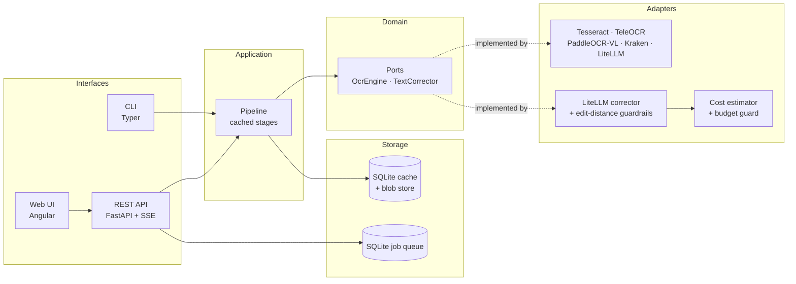

# scan2epub

**Turn scanned public-domain books into clean, reflowable EPUB 3 — with AI when you want it, fully offline when you don't.**

[](LICENSE)
[](https://www.python.org/)
[](CODE_OF_CONDUCT.md)

> Read it in your language: [Español (README.es.md)](README.es.md)

---

## Why

Scanned books from the 18th and 19th centuries are a mess to read on an e-reader:

- Long **ſ** (long s) and typographic ligatures (`ct`, `st`, `ſt`) instead of modern letters.
- **Hyphenation at the end of the line** splitting words across lines.
- Running **headers, footers and page numbers** on every page.
- Paragraphs that **break across pages**.
- Ink blots, skewed pages, foxing, warped binding.
- Two-column layouts, footnotes, illustrations, marginalia.

`scan2epub` rebuilds those pages as a **reflowable EPUB 3** document: you pick the
font, the size, the line height, the margins and the theme (light / dark /
sepia) and the reader does the rest.

It is built for **public-domain literature**, with a particular focus on
**Spanish-language** material from the 18th and 19th centuries.

## Before / after

| Scanned source page | Generated EPUB 3 (reflowable) |
| --- | --- |
|  |  |

> The same content: the running head is gone, the long `ſ` is normalised, the
> hyphenated words are rejoined and the paragraph flows naturally.
>
> The images are generated by `uv run python scripts/make_readme_images.py`.

## Quick start

### One command with Docker

```bash
docker compose up
```

Then open <http://localhost:8000> and drop a PDF in.

### Local install

```bash
git clone https://github.com/WassimAarab08/scan2epub.git
cd scan2epub
uv sync --all-extras
uv run scan2epub convert libro.pdf -o libro.epub
```

Requires Python 3.12+ and (for the default engine) the `tesseract` binary.

### The web interface

```bash
# The API and the job queue
uv run scan2epub serve --host 127.0.0.1 --port 8000

# The Angular application, in another terminal
cd web && npm install && npm start
```

<http://127.0.0.1:4200> asks for a PDF, shows the eight stages as they run,
and offers the finished book for download **or for reading in the page** —
one page or a spread, a plain or a book style, the type and the theme of your
choice, and a reading mode that takes the whole screen and hides every menu.
The reading progress is kept in the browser. The same conversion is available
over the REST API, documented at `/docs`: `POST /api/jobs` queues it and
`GET /api/jobs/{id}/events` streams its progress.

## CLI

```bash
# Local OCR only — fully offline, no API keys, no network
scan2epub convert libro.pdf -o libro.epub --ocr tesseract

# What does this installation support?
scan2epub doctor

# Local vision-language model (better on degraded scans)
scan2epub convert libro.pdf -o libro.epub --ocr teleocr

# Local VLM + local LLM post-correction via Ollama
scan2epub convert libro.pdf -o libro.epub --ocr paddleocr-vl --llm ollama/qwen3

# Remote VLM through LiteLLM (any OpenAI-compatible provider)
scan2epub convert libro.pdf -o libro.epub --ocr litellm/gemini-2.5-flash

# Show the estimated cost before spending money
scan2epub estimate libro.pdf --ocr litellm/gpt-4o-mini --llm litellm/gpt-4o-mini
```

More examples in [`docs/usage.md`](docs/usage.md).

## Features

- **Deterministic cleaning first.** Running heads, folio numbers, end-of-line
  hyphens, long `ſ`, ligatures and cross-page paragraphs are fixed with
  deterministic rules — no model required, fully reproducible.
- **Pluggable AI.** `OcrEngine` and `TextCorrector` are ports. Tesseract,
  TeleOCR, PaddleOCR-VL, Kraken, and any LiteLLM-supported remote model ship as
  adapters. Add your own in under 50 lines.
- **Safe LLM post-correction.** Corrections that drift too far from the original
  (normalized edit distance) are rejected and the original is kept. Every diff
  is stored for review.
- **Cost control.** Token and price estimation before a paid run and a hard
  budget cap: the run stops instead of spending more. API keys are only read
  from environment variables and are never logged.
- **Resumable.** Every stage is cached per page, keyed by content hash, so an
  interrupted 800-page job continues where it stopped.
- **Hand-written EPUB 3.** No `EbookLib`. The CSS is minimal and never forces a
  font or a font size, so reader preferences win.
- **Own reader.** An Angular application with drag-and-drop upload, the live
  stages of the conversion, and an integrated reader built on foliate-js:
  font, size, line height, margins, light/dark/sepia themes, a plain or a book
  style, one page or a spread, the saved progress and a reading mode that
  gives the book the whole screen.

## Architecture



Full details: [`docs/architecture.md`](docs/architecture.md).

## Project layout

```
src/scan2epub/
├── domain/           # Pure models and ports (no I/O, no framework imports)
├── application/      # Pipeline stages, cache, job orchestration
├── infrastructure/   # Adapters: OCR, correction, imaging, PDF, EPUB, storage
├── api/              # FastAPI app, routers, SSE, worker
├── cli/              # Typer commands
└── eval/             # CER / WER metrics and benchmark runner
web/                  # Angular interface with the integrated reader
```

## Testing

The suite has four layers. The browser one is the most telling: the
generated book is opened in **foliate-js**, the reference EPUB 3 reader, in a
real Chromium, and checked for reflow, working navigation and linked
footnotes.

```bash
uv run pytest                                        # everything
uv run pytest tests/browser -v                       # the real browser
uv run pytest --cov=src/scan2epub --cov-report=term  # with the coverage
```

See [`docs/testing.md`](docs/testing.md).

## Benchmarks

See [`docs/benchmarks.md`](docs/benchmarks.md) for the full table and the
reproduction script.

| Engine | Mode | CER ↓ | WER ↓ | Speed (s/page, RTX 4090) |
| --- | --- | --- | --- | --- |
| _TBD_ | | | | |

## Roadmap

The full plan, with the state of every piece, is in
[`docs/roadmap.md`](docs/roadmap.md).

| Phase | State | What it delivers |
| --- | --- | --- |
| 0 — Repository | ✅ 100 % | Repository, licence, documentation, CI, protected `main`. |
| 1 — MVP | ✅ 100 % | `scan2epub convert`: Tesseract → deterministic cleaning → a valid EPUB 3. |
| 2 — Local models | ◕ 90 % | The layout analyser, the vision-language engines, the resume and the CER/WER evaluation are done; the benchmark table has no numbers yet. |
| 3 — Remote models | ◕ 75 % | The LiteLLM corrector behind the guardrail, the modernisation, the cost estimate and the hard budget are done; a remote OCR adapter and the retries are not. |
| 4 — Service | ✅ 100 % | The API, the SQLite queue, the worker, the progress by SSE and the endpoints to list, cancel and resume. |
| 5 — Web interface | ◕ 80 % | The Angular application, the upload, the live stages and the integrated reader are done; the review view is not. |
| 6 — Release | ◔ 50 % | The images and the CI are done; the v0.1.0 release is not. |

**Contributions are welcome.** The issues labelled
[`good first issue`](https://github.com/WassimAarab08/scan2epub/labels/good%20first%20issue)
are the easiest way to start, and
[`docs/adding-an-engine.md`](docs/adding-an-engine.md) shows how to write an
OCR engine in fewer than fifty lines.

## Documentation

| Document | Contents |
| --- | --- |
| [`docs/architecture.md`](docs/architecture.md) | Layers, stage contracts, data model, the safety of the corrector |
| [`docs/web.md`](docs/web.md) | The job API, the stream of events and the reader |
| [`docs/roadmap.md`](docs/roadmap.md) | What is done, what is not, and where you can help |
| [`docs/adding-an-engine.md`](docs/adding-an-engine.md) | Write your own `OcrEngine` / `TextCorrector` in under 50 lines |
| [`docs/configuration.md`](docs/configuration.md) | `config.toml`, environment variables, providers |
| [`docs/usage.md`](docs/usage.md) | CLI reference and recipes |
| [`docs/testing.md`](docs/testing.md) | The four layers of the test suite and the browser tests |
| [`docs/epub-layout.md`](docs/epub-layout.md) | The anatomy of the generated EPUB, file by file |
| [`docs/benchmarks.md`](docs/benchmarks.md) | Evaluation methodology and results |
| [`docs/naming.md`](docs/naming.md) | Why the project is called `scan2epub` |
| [`CONTRIBUTING.md`](CONTRIBUTING.md) | The branching model, the development workflow, the commit conventions |
| [`SUPPORT.md`](SUPPORT.md) | How to get help and how to ask a good question |
| [`SECURITY.md`](SECURITY.md) | Reporting vulnerabilities |
| [`THIRD_PARTY_LICENSES.md`](THIRD_PARTY_LICENSES.md) | Dependency licenses and rejected copyleft libs |

## Contributing

Contributions are very welcome — see [CONTRIBUTING.md](CONTRIBUTING.md) and
[CODE_OF_CONDUCT.md](CODE_OF_CONDUCT.md). New OCR engines and correctors are
especially welcome; the guide shows how in under 50 lines.

`main` is **protected**: nothing is pushed to it directly. Every change is a
branch named `feat/…`, `fix/…`, `docs/…` or `chore/…`, opened as a pull
request, checked by the continuous integration and merged with a squash merge
that keeps the history linear. The details are in
[`CONTRIBUTING.md`](CONTRIBUTING.md#the-branching-model).

```bash
git checkout -b feat/my-engine
# … your changes …
git commit -s -m "feat(ocr): add my engine"
git push -u origin feat/my-engine
gh pr create --base main --fill
```

The issues labelled
[`good first issue`](https://github.com/WassimAarab08/scan2epub/labels/good%20first%20issue)
are the easiest way to start, and
[`docs/roadmap.md`](docs/roadmap.md) says what is still missing.

## License

[Apache License 2.0](LICENSE) — see also
[THIRD_PARTY_LICENSES.md](THIRD_PARTY_LICENSES.md).
