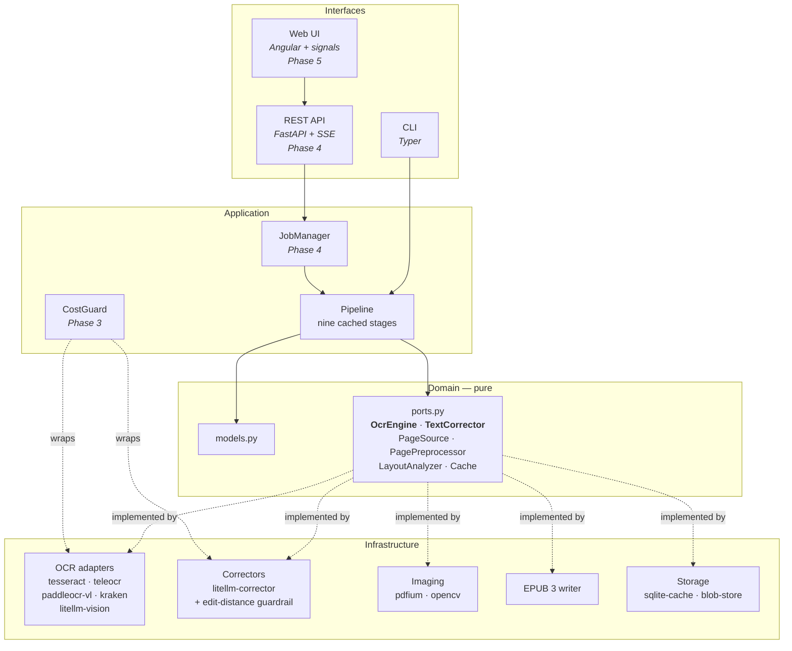

# Architecture

`scan2epub` is a light hexagonal architecture: the *domain* knows nothing about
the outside world, the *application* orchestrates the work, and the
*infrastructure* adapts the outside world to the ports declared by the domain.



## The dependency rule

`domain` imports nothing from the project but the standard library. `application`
imports `domain` and the ports, never an adapter. `infrastructure` imports
`domain` and implements the ports. `cli` and `api` depend on `application`.

The rule is checked mechanically: `pyright` in strict mode fails when a
module leaks a type it should not know about, and the test suite never
imports an adapter from the domain.

## The two ports

The whole point of the architecture is that the OCR engine and the text
corrector are interchangeable.

```python
class OcrEngine(Protocol):
    name: str

    def recognize(self, image: PageImage) -> list[TextBlock]: ...


class TextCorrector(Protocol):
    name: str

    def correct(self, blocks: Sequence[TextBlock]) -> CorrectionResult: ...
```

`OcrEngine` returns the blocks of a page in reading order, with the physical
lines preserved. `TextCorrector` returns the corrected blocks **and** the diffs
it produced, so the user can review them. The corrector is *not* trusted: the
application layer measures the distance between the original and the
correction and throws the correction away when it drifts too far.

See [`adding-an-engine.md`](adding-an-engine.md) for the full guide.

## The data model

| Object | Purpose |
| --- | --- |
| `PageImage` | A rasterised page of the source document. |
| `TextBlock` | A logical block of text, made of one or more physical lines. |
| `BBox` | A bounding box with **normalised** coordinates (`0.0 .. 1.0`). |
| `PageContent` | The recognised and cleaned text of a page. |
| `Chapter` | A division of the book that becomes one EPUB content document. |
| `Figure` | An illustration extracted from a page. |
| `Book` | The structured book, ready to be written. |
| `CorrectionResult` | The outcome of a correction, with the diffs. |

Two decisions are worth explaining.

**The physical lines are kept.** A block stores the lines it was printed on,
not a single blob of text. End-of-line hyphenation can only be repaired while
the line breaks are still known: `im-` + `prenta` is `imprenta`, but
`imprenta` alone no longer says where the word was broken.

**The coordinates are normalised.** A block that comes from a 300 dpi scan and
a block that comes from a vision model can be compared, because both are
expressed as fractions of the page.

## The nine stages

| # | Stage | Input → output | Model |
| --- | --- | --- | --- |
| 1 | `ingest` | PDF → `list[PageImage]` at 300 dpi, blank pages detected | deterministic |
| 2 | `preprocess` | `PageImage` → `PageImage`: deskew, frame removal, denoise, binarisation | deterministic |
| 3 | `layout` | `PageImage` → `PageLayout`: blocks, columns, footnotes, figures | heuristic (+ optional VLM) |
| 4 | `ocr` | `PageImage` → `list[TextBlock]` | **model** (`OcrEngine`) |
| 5 | `clean` | pages → cleaned pages | deterministic, no model |
| 6 | `correct` | pages → corrected pages | **model** (`TextCorrector`), optional |
| 7 | `structure` | pages → `Book`: chapters, table of contents, figures, notes | heuristic |
| 8 | `epub` | `Book` → EPUB 3 bytes | deterministic |
| 9 | `validate` | EPUB → report | deterministic (EPUBCheck) |

Stage 5 is the one that makes the tool useful without any model. It is the
difference between "an OCR dump" and "a book".

### What the cleaner does

1. **Normalises the historical characters.** The long s (`ſ`) becomes a plain
   `s`, the Latin ligatures (`fi`, `fl`, `ffi`, `ffl`, `ſt`) are expanded, soft
   hyphens and zero-width spaces disappear, exotic spaces become plain ones.
2. **Finds the running heads.** A short block that sits in the header or the
   footer zone and repeats on at least three pages is furniture, not content.
   A block that only appears on one page is never removed.
3. **Finds the folios.** A block made only of digits and punctuation, in the
   footer zone, is a page number.
4. **Rebuilds the paragraphs.** OCR engines routinely return one block per
   printed line. The blocks are gathered back together while the previous one
   does not close a sentence. A footnote never interrupts a paragraph; a
   heading always ends one.
5. **Rejoins the hyphenated words.** A line that ends with a hyphen followed
   by a lowercase letter is one word. The hyphen is dropped and the two halves
   are glued without a space.
6. **Merges the paragraphs that continue on the next page.**
7. **Marks the footnotes.** A numbered note at the bottom of the page becomes
   an EPUB note. The very same note, with the very same number, on three
   pages or more is boilerplate and is removed.

Every rule is a pure function of the recognised text and its geometry. Running
the pipeline twice gives the same book, and the test suite asserts it.

## The cache and the resumability

The key of a cached artefact is:

```
sha256(stage ‖ stage_version ‖ sha256(input) ‖ sha256(relevant_config))
```

- The **SQLite** layer (`cache.db`) stores the index: `stage`, `page`,
  `key`, `artifact_id`.
- The **blob store** (`blobs/ab/cd/<sha256>`) stores the artefacts themselves:
  the page images and the recognition results.

Because the key includes the configuration, changing the resolution or the
cleaning options invalidates **only** the stages that depend on them. A job
that was interrupted at page 512 continues at page 512.

## The EPUB

The EPUB is assembled by hand, without `EbookLib`. The anatomy of the file is
described in [`epub-layout.md`](epub-layout.md).

Two rules drive the markup:

* The stylesheet **never** declares a font family, a font size, a line height
  or the body margin, so the reading preferences of the e-reader always win.
  This is verified by a browser test that measures the computed style.
* Every text that comes from the OCR is XML-escaped. No user content is ever
  interpreted as markup.

## The safety of the LLM corrector

The corrector is the only component that can change the words of the book, so
it is fenced in:

| Guardrail | Default | Where |
| --- | --- | --- |
| Maximum normalised edit distance | `0.12` | `application/stages/correct.py` |
| Maximum relative length change | `±25 %` | `application/stages/correct.py` |
| The prompt forbids rewriting | — | `infrastructure/correction/` |
| Every diff is stored | always | `CorrectionResult.entries` |
| `--modernize` is off | off | `config.toml` |

A correction that breaks a guardrail is **discarded** and the original text is
kept. The distance is measured with a banded Levenshtein algorithm
(`domain/distance.py`) that stays fast on long paragraphs.

## The cost control

The remote adapters never call a provider without a budget:

1. `scan2epub estimate` computes the tokens and the price of the run *before*
   anything is sent.
2. The budget is enforced **locally**, not reported: the run stops when the
   limit is reached.
3. The retries use an exponential backoff and the calls are rate limited.
4. The API keys are read from the environment, never from the configuration
   file, and the logger redacts them.

## The folder layout

```
src/scan2epub/
├── domain/           # models, ports, normalisation, edit distance
├── application/      # pipeline, stages, cache, progress
├── infrastructure/   # adapters
├── api/              # FastAPI application, worker, SSE      (Phase 4)
├── cli/              # Typer commands
└── eval/             # CER / WER metrics and runner          (Phase 2)
```

## The phases

| Phase | Delivers |
| --- | --- |
| 0 | Repository, licence, documentation, CI skeleton |
| 1 | End-to-end CLI: Tesseract → deterministic cleaning → valid EPUB 3 |
| 2 | Local VLM engines, cache and resume, CER/WER evaluation |
| 3 | LiteLLM: remote OCR, LLM correction, guardrails, cost control |
| 4 | FastAPI, SQLite job queue, worker, SSE progress |
| 5 | Angular web UI, page-by-page review, integrated reader |
| 6 | Docker (CPU/GPU), full CI, documentation, v0.1.0 |
